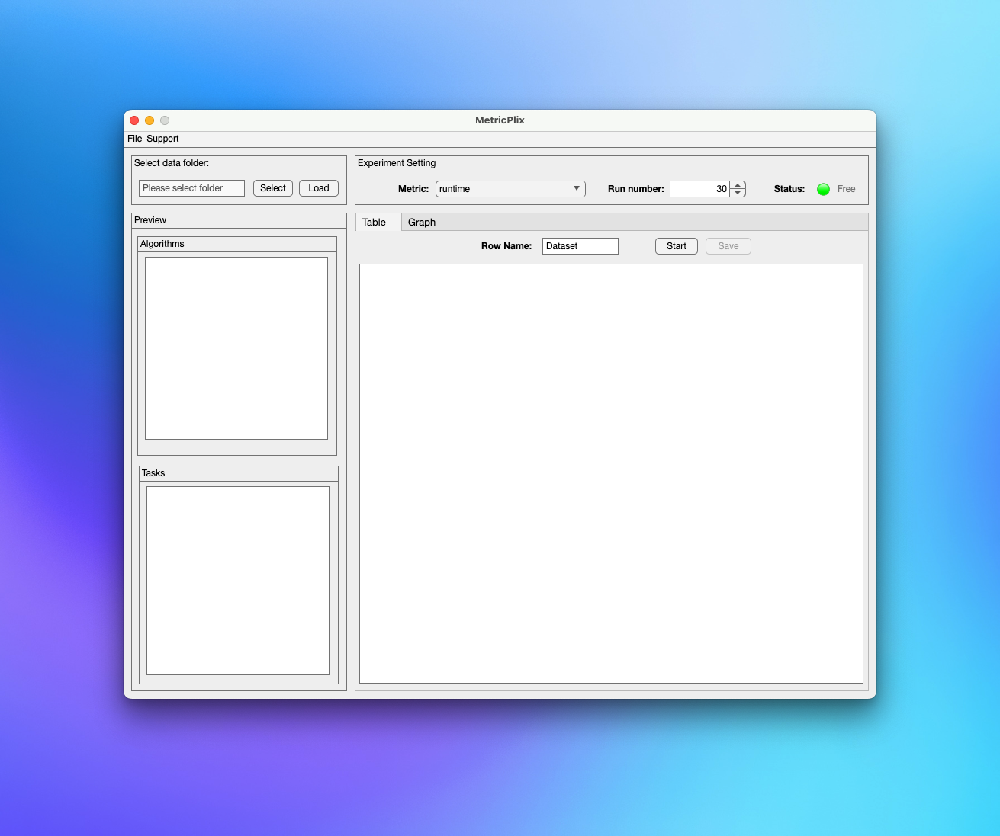
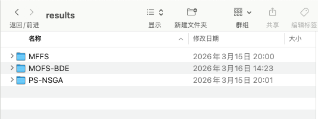
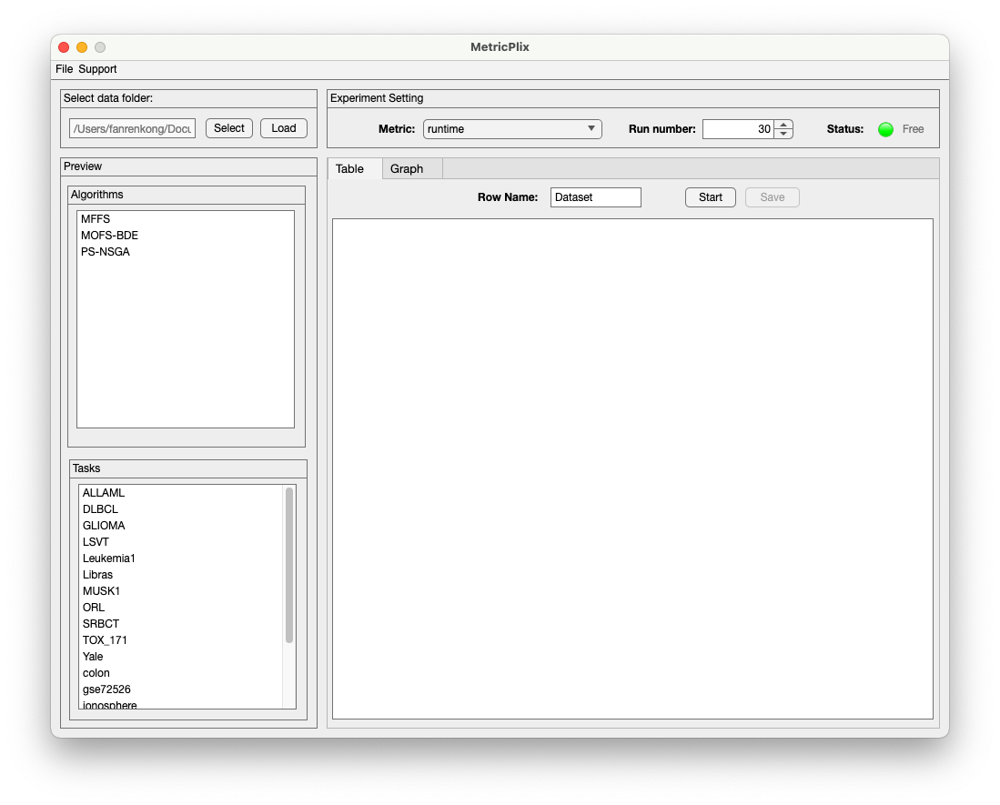
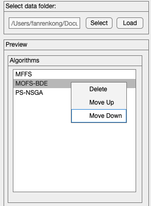
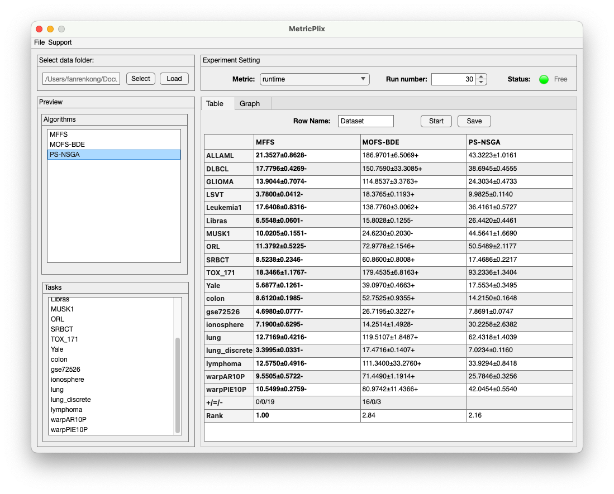
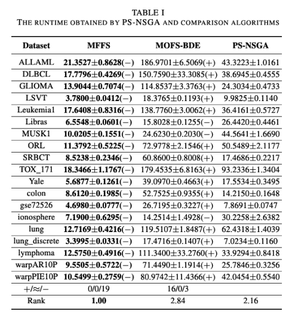

<p align="center">
  
</p>

<h1 align="center">MetricPlix</h1>

<p align="center"><em>Metrics. Plots. Mix.</em></p>

<p align="center"><a href="README.md">English</a> | <strong>简体中文</strong></p>

MetricPlix 是一个基于 MATLAB App Designer 开发的实验结果分析工具，适用于多算法、多任务、多轮独立运行的对比实验。软件按照统一的目录结构读取 MAT 文件，通过内置或自定义指标计算结果，完成统计检验，并导出可用于论文的 LaTeX 表格。



## 功能

- **实验数据导入**：按照“算法 / 任务 / 运行轮次”的目录结构读取结果。
- **指标分析**：提供运行时间指标示例，支持按实验需求扩展自定义指标。
- **结果汇总**：以“均值 ± 标准差”展示各算法在各任务上的结果，并加粗标记最佳结果。
- **统计检验**：支持 Wilcoxon 秩和检验、跨任务的 `+/=/-` 汇总，以及 Friedman 平均排名。
- **分析配置保存**：保存数据路径、算法与任务顺序、指标、运行轮数等设置，便于后续复用。
- **LaTeX 导出**：导出包含统计符号、最佳结果加粗和排名的 `.tex` 文件。
- **自定义指标**：按照统一函数接口扩展指标，无需修改主程序。

Graph 页面目前显示 **Coming Soon~**，绘图功能尚未开放。

## 运行环境

- MATLAB。当前项目已在 **MATLAB R2024a** 中运行验证。
- Statistics and Machine Learning Toolbox：统计检验使用 `ranksum` 和 `friedman`，即使只分析运行时间也需要此工具箱。

运行方式：

1. 下载或克隆本仓库。
2. 在 MATLAB 中将当前文件夹切换至项目根目录。
3. 在命令窗口执行：

```matlab
% 当前文件夹应为 MetricPlix 项目根目录
addpath(pwd);
metricPlix;
```

也可以在 App Designer 中打开 `metricPlix.mlapp` 后点击 Run；运行前请将项目根目录加入 MATLAB 搜索路径。

## 数据目录结构

将实验结果整理为以下结构：

```text
results/                       # 导入时选择这一层
├── AlgorithmA/                # 算法名，对应表格列
│   ├── Task1/                 # 任务名或数据集名，对应表格行
│   │   ├── 1.mat              # 第 1 轮结果
│   │   ├── 2.mat              # 第 2 轮结果
│   │   └── ...
│   └── Task2/
│       ├── 1.mat
│       ├── 2.mat
│       └── ...
└── AlgorithmB/
    ├── Task1/
    │   ├── 1.mat
    │   ├── 2.mat
    │   └── ...
    └── Task2/
        ├── 1.mat
        ├── 2.mat
        └── ...
```

数据约定：

- 一级子目录名作为算法名称，二级子目录名作为任务名称。
- Load 会读取当前算法列表下**共有的任务**；同一任务在不同算法下应使用相同名称。
- 运行文件从 `1.mat` 开始连续编号。若 Run number 为 `30`，每个参与分析的算法与任务组合都需要有 `1.mat` 至 `30.mat`。
- 软件按照指定轮数读取文件，不会自动推断轮数，也不会自动跳过缺失轮次。
- MAT 文件内的变量由所选指标决定。软件将 `load` 返回的结构体直接传入指标函数，并不强制所有指标使用同一组字段。

例如，内置 `runtime` 指标读取 `data.runTime`，对应文件可这样保存：

```matlab
runTime = 12.34;  % 示例运行时间；所有实验应保持相同单位
save('1.mat', 'runTime');
```

## 使用方法

### 1. 导入实验结果



点击 Select，选择结果根目录，例如上面的 `results/`。Algorithms 列表会显示检测到的算法。

可先通过右键菜单删除不参与比较的算法，再点击 Load，加载这些算法共有的任务。Tasks 列表同样支持删除与上下移动。



### 2. 设置分析参数

| 参数 | 说明 |
| --- | --- |
| Metric | 本次分析使用的指标 |
| Run number | 每个算法在每个任务上读取的运行轮数，默认 30 |
| Row Name | 导出表格左上角的行标题，默认 `Dataset` |

**算法列表的最后一项是统计检验的基准算法。** 若希望以某个算法为基准，请使用右键菜单将其移动到最后。算法和任务的排列顺序也决定结果表的列顺序与行顺序。



### 3. 生成与理解结果

点击 Start 开始分析，状态指示灯会切换为 Busy，计算结束后恢复为 Free。

表格内容包括：

- **任务结果**：各轮指标展示值的均值与样本标准差，保留四位小数；每个任务按比较值的均值选出一个最佳算法并加粗。
- **显著性符号**：前面的算法列分别与最后一列基准算法进行 Wilcoxon 秩和检验，阈值为 `p < 0.05`。
- **`+/=/-` 行**：按各任务的检验符号汇总次数。
- **Rank 行**：对各任务上比较值的均值进行 Friedman 检验并展示平均排名，排名越小越好，最佳排名加粗。

符号含义如下，均以**最后一列基准算法**为参照：

| 符号 | 含义 |
| --- | --- |
| `+` | 基准算法显著优于当前列算法 |
| `=` | 差异不显著，或比较值的均值相同 |
| `-` | 基准算法显著劣于当前列算法 |

例如，MOFS-BDE列汇总为 `16/0/3`，表示基准算法相对该列算法在 16 个任务上显著更优、0 个任务上记为相当、3 个任务上显著更差。

只有一个算法时不进行算法间统计检验；Friedman 排名需要至少两个算法和两个任务。当前 Wilcoxon 检验使用的是非配对秩和检验 `ranksum`。



### 4. 保存与复用配置

通过 **File → Save** 将当前工作配置保存为 `.mat` 文件；后续通过 **File → Open** 读取配置，再点击 Start 重新计算。

配置包含结果目录、算法与任务列表及顺序、指标、运行轮数和行标题等设置，不包含原始实验数据或已计算的结果表。数据目录移动后，需要重新选择路径。

建议完成一次分析、确认参数后再保存配置。当前指标和轮数是在点击 Start 时写入工作配置的；修改这两项后，请重新点击 Start 再保存。

### 5. 导出 LaTeX 表格

分析完成后，设置 Row Name，点击 Table 页内的 Save，将结果保存为 `.tex` 文件。

导出文件包含 IEEEtran 文档外壳和 `table*` 表格环境，可在具备相应文档类与宏包的 LaTeX 环境中编译预览，也可以提取表格部分加入论文。统计符号、均值与标准差中的 `\pm`、最佳结果加粗和排名会一并导出。导出时，界面中的 `=` 会表示为 `\approx`。

加入论文后，请按实际内容调整表格标题、标签、列宽及排版。算法名和任务名中的下划线会自动转义，其他 LaTeX 特殊字符需要自行检查。



## 自定义指标

### 目录与命名

在 `metrics/` 下创建指标目录，并在其中放置对应函数：

```text
metrics/
└── MyScore/
    └── MyScoreMetric.m
```

目录名是界面中显示的指标名，函数名和文件名必须为“目录名 + `Metric`”，并使用合法的 MATLAB 函数名称。新增后重新启动软件，下拉框会自动加载该目录。

### 函数接口

```matlab
function [realValue, refValue] = MyScoreMetric(data, taskName)
    % data：load('某一轮.mat') 返回的结构体
    % taskName：当前任务目录名，可用于匹配参考数据
    % realValue：本轮的指标展示值
    % refValue：本轮用于统计检验、最佳值选择和排名的比较值

    realValue = data.score;
    refValue = realValue;  % 本例假设 score 越小越好
end
```

每次调用处理一个算法在一个任务上的一轮结果。两个返回值都应为有限的实数标量；跨轮的均值、标准差及统计检验由主程序完成。

**`refValue` 必须统一为越小越好。** 软件使用 `realValue` 生成“均值 ± 标准差”，使用 `refValue` 选择最佳算法、执行统计检验和计算排名。

| 指标方向 | 返回值设置 |
| --- | --- |
| 越小越好，例如错误率、运行时间 | `refValue = realValue` |
| 越大越好，例如准确率 | `refValue = -realValue` |

例如，自定义一个直接读取准确率的指标：

```text
metrics/
└── MyAccuracy/
    └── MyAccuracyMetric.m
```

```matlab
function [realValue, refValue] = MyAccuracyMetric(data, taskName)
    realValue = data.accuracy;
    refValue = -realValue;
end
```

对应的运行结果文件应将 `accuracy` 保存为顶层变量：

```matlab
accuracy = 0.95;
save('1.mat', 'accuracy');
```

添加到软件前，可在命令窗口单独检查一次：

```matlab
addpath(fullfile(pwd, 'metrics', 'MyAccuracy'));
data = load(fullfile('results', 'AlgorithmA', 'Task1', '1.mat'));
[realValue, refValue] = MyAccuracyMetric(data, 'Task1');
```

如果自定义指标依赖任务参考数据，建议根据 `mfilename('fullpath')` 定位指标目录，再用 `taskName` 构建文件路径，避免依赖当前工作目录。

## 项目结构

```text
MetricPlix/
├── metricPlix.mlapp          # 主程序及界面
├── docs/images/             # README 截图
├── metrics/                 # 内置与自定义指标、指标参考数据
├── resources/               # Logo 等界面资源
├── templates/               # 模板预留目录
├── README.md                # 英文说明
└── README.zh-CN.md          # 中文说明
```

## 反馈与联系

问题反馈和功能建议可通过 [GitHub Issues](https://github.com/fanrenkong/MetricPlix/issues) 提交。报告问题时，请附上 MATLAB 版本、所选指标、目录结构和报错信息；如需提供实验文件，可使用可复现问题的最小示例。

- 作者：Kevin Kong
- 邮箱：[kevin@fanrenkong.com](mailto:kevin@fanrenkong.com)
- 个人网站：[www.fanrenkong.com](https://www.fanrenkong.com)

